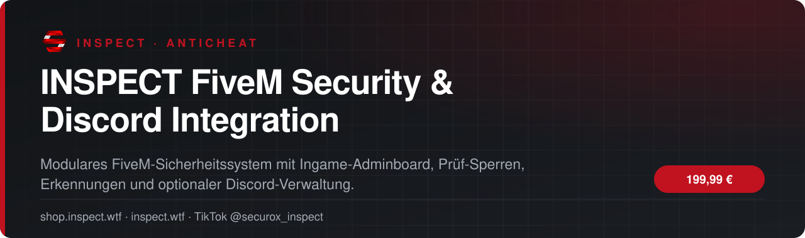
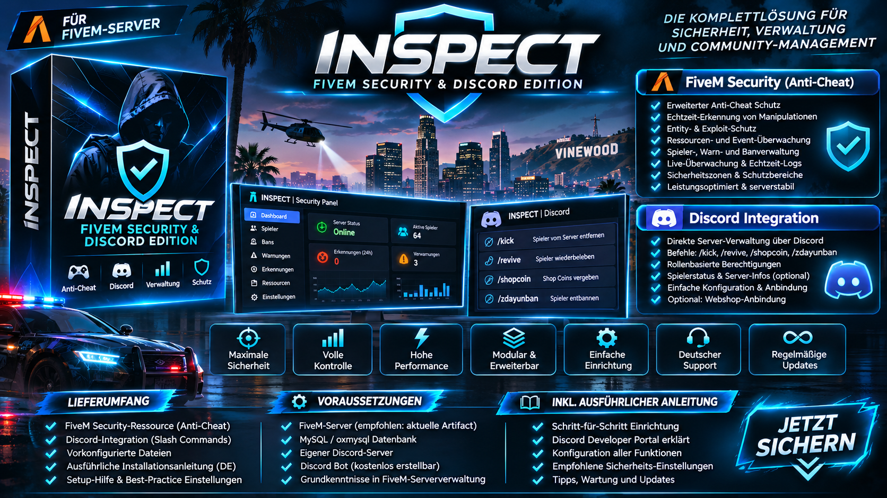

<!-- inspect-showcase: automatisch erzeugt, Änderungen bitte im Shop vornehmen -->

  
  
  
  
  

  
  
  

 

 

## Das Wichtigste auf einen Blick

<table>
  <tr>
    <td width="50%" valign="top">✔&nbsp; <b>FiveM Anti-Cheat mit Ingame-Adminboard und konfigurierbaren Prüfprofilen</b></td>
    <td width="50%" valign="top">✔&nbsp; <b>Live-Status, Erkennungen und Vorfallsprotokoll</b></td>
  </tr>
  <tr>
    <td width="50%" valign="top">✔&nbsp; <b>Serverseitige Bewegungs-, Entity-, Event-, Combat- und Explosionsprüfungen</b></td>
    <td width="50%" valign="top">✔&nbsp; <b>Prüf-Sperren, Banverwaltung, Team-Ausnahmen und Audit-Logs</b></td>
  </tr>
</table>

## Überblick

#### INSPECT FiveM Security & Discord Integration

#### Eine Sicherheitszentrale für dein FiveM-Projekt

**Anti-Cheat, Live-Adminboard und Discord-Verwaltung – in einem modularen Paket für FiveM-Server.** Die INSPECT Security Edition vereint eine vielseitige, konfigurierbare Sicherheitsressource mit einer optionalen Discord-Integration für spielbezogene Verwaltungsaufgaben.

#### Die wichtigsten Funktionen

**FiveM Security / Anti-Cheat**  
- Ingame-Sicherheits-Dashboard mit Live-Konfiguration und Prüfübersicht.  
- Erkennungen für auffällige Bewegungen, Freecam, Noclip, Explosions- und Entity-Ereignisse, Waffen-/Combat-Aktivitäten und weitere Signale.  
- Prüf-Sperren, Banverwaltung und serverseitige Vorfallprotokolle.  
- Event-Manager, Ressourcenscan, Integrationskontrolle und definierte Ausnahmen.  
- Sicherheitszonen, Objektinspektion sowie bestätigungspflichtiger Entity-Cleanup.  
- Screenshot- und Live-Beobachtungsfunktionen mit Zugriffskontrollen.  
- Live-Profile als Beobachtungsstart (weitere Guard-Module separat konfigurierbar).

**Discord Management für FiveM (optional)**  
- Slash-Befehle `/kick`, `/revive`, `/shopcoin` und `/zdayunban` (letzterer für separate EntityGuard-SQL-Datenbank).  
- Rollenbasierte Berechtigungen für jeden Befehl.  
- Live-Spielerzahl als Discord-Bot-Aktivität.  
- Shopcoin-Verwaltung mit Offline-Vormerkung.  
- Webhook-Logs und optionale API-Integration in ein kompatibles Webshopsystem.

#### Lieferung

Du erhältst die beiden originalnamenkompatiblen FiveM-Ressourcen als Quellcode, eine vollständig bereinigte Neuinstallations-Konfiguration, deutsche Schritt-für-Schritt-Anleitungen für FiveM/Discord, einen `.env`-Konfigurator als Vorlage, eine Beispiel-server.cfg, Troubleshooting, Datenschutz-/Sicherheitshinweise sowie Update- und Backup-Anleitungen.

#### Technische Voraussetzungen

Ein eigener FiveM FXServer ist erforderlich. Für die Discord-Befehle sind eine eigene Bot-Anwendung und `oxmysql` nötig; einzelne Befehle benötigen ESX/QBCore oder ein spezifisches SQL-Schema. Für Shop-Bestellungen ist ein **zusätzliches kompatibles Shop-API** erforderlich. Hosting, Webshop und separater AC-Bridge-Empfänger sind nicht enthalten.

**Hinweise:** Schalte Auto-Sanktionen nur nach Tests frei. Bildaufnahmen/Spielerdaten verantwortungsvoll und datenschutzkonform einsetzen. Die kommerziellen Weitergaberechte der enthaltenen Bestandteile müssen vor Veröffentlichung geklärt werden. Kein garantierter Schutz gegen alle Cheats. Die Discord-Integration ist kein vollständiges Ticketsystem und nicht identisch mit einem separaten Discord-Community-Bot.

## Kompatibilität

| | |
|:--|:--|
| Frameworks | **ESX** · **QBCore** |
| Plattform | FiveM (GTA V) |

## Alle weiteren Funktionen

- Ressourcen-Scanner, Event Manager, Sicherheitszonen und Integrationsfunktionen
- Objektinspektion und bestätigungspflichtiger Objekt-Cleanup
- Screenshot- und Live-Beobachtung (Datenschutz beachten)
- Optionaler Discord-Bot mit /kick, /revive, /shopcoin und /zdayunban
- Individuelle Rollenberechtigungen und Discord-Spielerstatus
- Offline-Shopcoin-Vormerkung und optionale Shop-API-Bridge
- Frische Datenbasis ohne vorherige Kunden-, Spieler-, Ban- oder Token-Daten
- Deutsche Entwicklerportal-, ACE-, SQL-, Setup- und Update-Anleitungen
- Live-Profile starten auf observe; unabhängige Schutzmodule benötigen separate Prüfung
- Benötigt eigenen FiveM FXServer; Discord-Bot benötigt oxmysql und eigene Discord-App

<b>1 weitere Funktionen anzeigen</b>

- Externer Webshop, Hosting und privater AC-Bridge-Empfänger nicht enthalten

## Preis

**199,99 €** &nbsp;–&nbsp; einmaliger Kaufpreis · Download und Lizenz im Kundenkonto

Sichere Zahlung mit PayPal oder Kreditkarte · Rechnung als PDF · Support auf Deutsch

## So einfach geht's

1. **Im Shop kaufen** – sicher bezahlen mit PayPal oder Kreditkarte.
2. **Sofort loslegen** – Download und Lizenz stehen direkt nach Zahlungseingang in deinem Kundenkonto bereit, die Rechnung erhältst du als PDF.
3. **Einrichten** – bei Fragen hilft dir unser Support im Discord weiter.

## Warum INSPECT?

<table>
  <tr>
    <td width="50%" valign="top"><b>🇩🇪 Entwickelt in Deutschland</b> Konzeption, Entwicklung und Support aus einer Hand.</td>
    <td width="50%" valign="top"><b>💬 Persönlicher Support</b> Schnelle Hilfe auf Deutsch im INSPECT Discord.</td>
  </tr>
  <tr>
    <td width="50%" valign="top"><b>🔒 Sichere Zahlung</b> PayPal oder Kreditkarte, Rechnung automatisch als PDF.</td>
    <td width="50%" valign="top"><b>⚡ Sofort verfügbar</b> Download und Lizenz direkt nach der Zahlung im Kundenkonto.</td>
  </tr>
</table>

## Häufige Fragen

<b>Wie erhalte ich das Produkt?</b>

 

Nach bestätigter Zahlung stehen Download und Lizenz in deinem Kundenkonto bereit. Die Rechnung erhältst du als PDF.

<b>Welche Frameworks werden unterstützt?</b>

 

ESX, QBCore.

<b>Bekomme ich Hilfe bei der Einrichtung?</b>

 

Ja – unser Support hilft dir im [INSPECT Discord](https://discord.gg/inspect) persönlich und auf Deutsch.

<b>Wo kaufe ich offiziell?</b>

 

Ausschließlich im INSPECT Shop unter [shop.inspect.wtf](https://shop.inspect.wtf). Angebote von Dritten stammen nicht von uns.

## Kontakt

| | |
|:--|:--|
| 🛒 Shop | [shop.inspect.wtf](https://shop.inspect.wtf) |
| 🌐 Website | [inspect.wtf](https://inspect.wtf) |
| 💬 Discord | [discord.gg/inspect](https://discord.gg/inspect) |
| 🎬 TikTok | [@securox_inspect](https://www.tiktok.com/@securox_inspect) |
| ✉️ E-Mail | [info@inspect.wtf](mailto:info@inspect.wtf) |

---

<b>SecuroX Inspect</b> · Offizielle Produktpräsentation · Dieses Repository enthält keinen Quellcode und keine Produktdateien. 
Kauf und Lizenzen ausschließlich über <a href="https://shop.inspect.wtf">shop.inspect.wtf</a> · Inhalte werden automatisch aus dem Shop aktualisiert.

